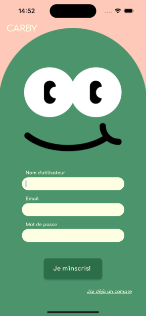
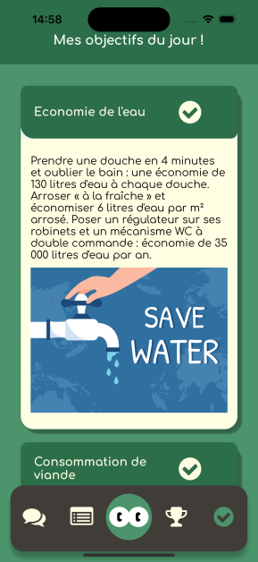
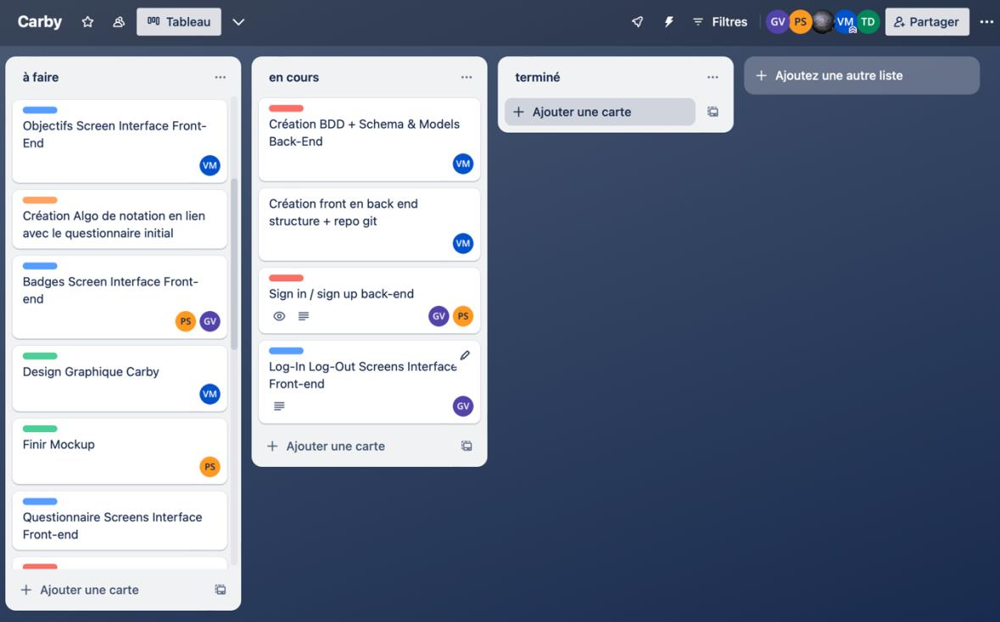

# Carby — Product Case Study

**From user research to an eco-conscious mobile app prototype**  
*Team project · La Capsule Lyon · May 2024*

Carby is a mobile app prototype designed to help people adopt more sustainable everyday habits. Users answer a short questionnaire to build an environmental profile, receive personalised challenges and track their progress through points, levels and badges.

This repository documents **the product thinking and delivery process behind Carby**: understanding users, designing journeys, organising development and making trade-offs under a tight deadline.

**[Read the full Product Case Study (PDF)](./Etude_de_cas_Product_Carby.pdf)**

## Project at a glance

| | |
| --- | --- |
| **Context** | Final team project at La Capsule Lyon |
| **Team** | 5 people |
| **Timeline** | 2 weeks, 4 development sprints |
| **Methods** | User feedback, storyboards, user journeys, wireframes, Agile-style sprint planning |
| **Tools** | Figma, Miro, Trello, Git/GitHub, React Native, Node.js/Express, MongoDB |

## The challenge

How might we make everyday sustainable actions **easier to understand, motivating and engaging**?

The concept combined personalised daily goals, gamification and a community space. Our main challenge was to build a coherent experience within two weeks, while adapting the scope to our technical and time constraints.

## Our approach

### 1. Understand user needs

We presented early storyboards to a panel of **four users** and documented user journeys. Their feedback highlighted areas of friction, including the onboarding questionnaire, navigation to the profile and explanations of goals and badges.

These insights informed proposed improvements, such as shorter questions, a clearer route to the profile and contextual guidance.

### 2. Design the experience

We used **Miro** for storyboards and wireframes, then **Figma** for the visual system and interface mock-ups. The aim was to keep the experience approachable while making progress and daily tasks easy to understand.




*Screens from the project design mock-ups, not evidence of a public product launch.*

### 3. Organise and deliver

We organised the work into **four short sprints using Trello**, with tasks shared across interface design, front-end and back-end development. Regular team discussions helped us resolve blockers and adjust priorities.



### 4. Make a product trade-off

The original community feature was too ambitious for the available time. **As a team, we reduced its scope to basic message posting** and left more advanced social interactions for a possible later iteration.

This was an important lesson in balancing user value, delivery effort and deadlines.

## My contribution

I contributed to **user-journey design, project organisation and React Native front-end development**, including the authentication flow and API integration. I also wrote the original presentation report documenting the team's approach and technical decisions.

**This was a collaborative project.** I was not the project's formally appointed Product Owner; research, prioritisation and delivery decisions were made with the team.

## Outcome and lessons learned

The prototype included an environmental profile, daily objectives, gamified progression (XP, levels and badges), an articles section and a simplified community feature.

Three lessons I carry forward into Product Ownership:

- **Listen before building:** user feedback can reveal problems that early wireframes miss.
- **Prioritise the right scope:** it is better to deliver a coherent core experience than too many incomplete features.
- **Plan quality early:** automated tests were considered but could not be fully implemented within the deadline.

The project did **not** measure real-world adoption or environmental impact, so no user-growth or impact metrics are claimed here.

## Repository contents

```text
.
├── README.md
├── Etude_de_cas_Product_Carby.pdf       # 2-page product case study
├── Etude_de_cas_Product_Carby.tex       # Editable LaTeX source
└── images/                               # Illustrations used in the case study
    ├── 01_inscription.png
    ├── 02_objectifs.png
    ├── 03_trello_sprint1.jpg
    └── 04_storyboard_final.jpg
```

To edit the case study, open the `.tex` file in **Overleaf** alongside the `images/` folder and compile with **pdfLaTeX**. Image files can be replaced while keeping the same filenames.

## Project links

- [Front-end source code](https://github.com/blenkcode/carby-frontend)
- [Back-end source code](https://github.com/blenkcode/carby-backend)
- [My portfolio](https://portfoliogaelvbn.vercel.app/)

---

**Gaël Vanbeveren** · Exploring Product Ownership, user experience and digital project delivery.
